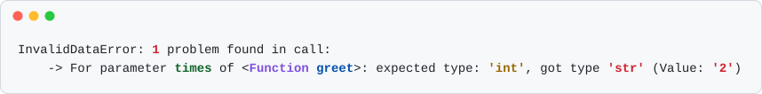
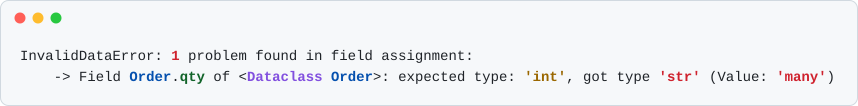
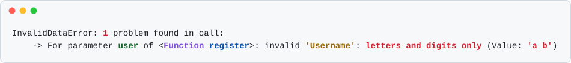
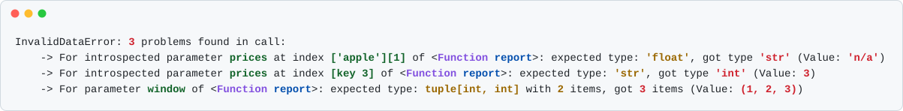
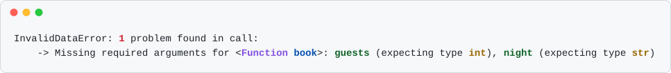
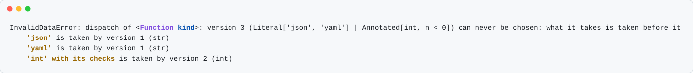
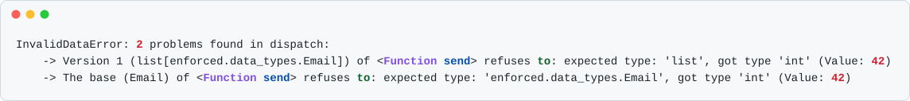
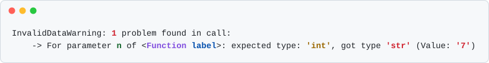

<div align="center">

# enforced

**Runtime validation for Python, from the annotations you already write.**


</div>

<!-- render: hero -->
```python
from enforced import validate

@validate
def greet(name: str, times: int = 1) -> str:
    return f"Hello, {name}! " * times

greet("Ana", 2)      # -> 'Hello, Ana! Hello, Ana! '
greet("Ana", "2")    # InvalidDataError, shown below
```

<picture>
  <source media="(prefers-color-scheme: dark)" srcset="assets/readme/hero-dark.svg">
  
</picture>

No models, no schemas, no new syntax: decorate a function, a class or a dataclass, and its type hints are checked on every call.

- ⚡ **Fast.** About 60 ns for a one-parameter call: under a third of pydantic's `validate_call`.
- 🎯 **Strict by default.** `"2"` never quietly becomes `2`, and `True` is not an `int`. Parsing is opt-in.
- 📋 **Every problem at once**, as readable text or as data for an API response.
- 🔍 **Deep when you ask.** `deep=True` checks every item of `list[int]`, `dict[str, list[float]]`, a `TypedDict` ...
- 🧩 **Drop-in dataclass.** Swap `from dataclasses import dataclass` for `from enforced import dataclass`.
- 📦 **No dependencies**, and fully typed for mypy, pyright and your editor.

**Contents:** [Install](#install) · [Functions](#functions) · [Classes](#classes) · [Dataclasses](#dataclasses) · [Validated values](#validated-values) · [Conversion](#conversion-and-coercion) · [Collections](#checking-collection-items) · [Errors](#errors) · [Dispatch](#dispatch) · [More](#more) · [Options](#options) · [Compared](#compared-with-beartype-and-pydantic) · [Performance](#performance) · [Limitations](#limitations)

## Install

```bash
pip install .            # from the repository root; Python 3.14+
```

## Functions

```python
from enforced import validate

@validate(check_return = True)
def area(width: float, height: float) -> float:
    return width * height

area(3, 4)          # -> 12.0
area("3", None)     # InvalidDataError: both arguments are reported
```

Ints are accepted for a `float` and converted. Every kind of parameter is checked, `*args` and `**kwargs` included:

```python
from enforced import validate

@validate
def log(level: int, *parts: str, sep: str = " ") -> str:
    return sep.join(parts)

log(1, "a", "b")    # -> 'a b'
log(1, "a", 3)      # InvalidDataError: for parameter parts[1]
```

Async functions are checked when awaited, generators when called, and an object with `__call__` or a `functools.partial` against the function it calls. `typing.no_type_check` leaves a function unchecked.

## Classes

`@enforce` checks `__init__`, every method the class defines, property setters, and what is assigned to the attributes it annotates:

```python
from typing import Self
from enforced import enforce

@enforce
class Account:
    owner: str
    balance: float

    def __init__(self, owner: str, balance: float = 0) -> None:
        self.owner, self.balance = owner, balance

    def deposit(self, amount: float) -> Self:
        self.balance += amount
        return self

    @enforce.exempt                     # this one is left alone
    def dump(self, sink) -> None:
        print(self.owner, self.balance, file = sink)

account = Account("Ana").deposit(10)
account.balance                         # -> 10.0
Account(42)                             # InvalidDataError: for <Class Account>
account.deposit("lots")                 # InvalidDataError: for <Method Account.deposit>
account.balance = "lots"                # InvalidDataError: Attribute Account.balance of <Class Account>
account.note = "anything"               # not annotated: not checked
```

> [!WARNING]
> **Only annotations in the class body are checked.** `self.balance: float = balance` inside `__init__` is kept nowhere by Python at run time (PEP 526), so that attribute takes anything. Write `balance: float` in the class body.

<details>
<summary>What else <code>@enforce</code> does</summary>

- **`Self`** is the class the method is called on, so an inherited method follows the subclass.
- **Special methods** a caller hands values to are checked: `__call__`, `__getitem__`, `__setitem__`, `__delitem__`, `__contains__`, `__missing__`, `__format__`, `__new__`. Those Python calls itself (`__eq__`, `__add__`, `__repr__` ...) are left alone, so `account == "x"` stays `False`.
- **A method with its own `@validate(...)`** keeps its own options; one without annotations stays the plain function.
- **Attributes:** the class's options apply to them. A `ClassVar`, a name a property takes care of, and assignments to the class itself are left alone. A `__setattr__` of your own runs after the check. `check_assignment=False` turns attribute checks off.
- **Cost:** a class with annotated attributes pays on every assignment (about 75 ns, 55 for an unannotated name); one without gets no `__setattr__`.
- `@validate` also works on a single method of any class, above or below `@classmethod`, `@staticmethod` and `@property`.

</details>

### A base class: `Enforced`

`@enforce` checks the class it decorates. Inherit from `Enforced` instead, and every class derived from it is checked, with the options as class keywords:

```python
from enforced import Enforced

class Schema(Enforced, deep = True):                  # a library's base
    def load(self, rows: list[dict[str, float]]) -> int:
        return len(rows)

class Prices(Schema, check_return = True):            # a user's class: no decorator
    def scale(self, factor: float) -> float:
        return factor

Prices().scale(2)                                     # -> 2.0
Prices().scale("x")                                   # InvalidDataError: for <Method Prices.scale>
Prices().load([{"apple": "n/a"}])                     # InvalidDataError: deep=True, from Schema
```

A class that names no option takes its base's, and each one it names replaces that one only. `Enforced` adds no metaclass and no instance attribute, so it combines with any other base.

| You have | Use |
|---|---|
| A function or one method | `@validate` |
| A class | `@enforce` |
| A class hierarchy, checked down to every subclass | inherit from `Enforced` |
| A dataclass | `@dataclass` (enforced's) |

## Dataclasses

`enforced.dataclass` takes every argument of the standard one, and checks construction, defaults, assignment and the methods:

<!-- render: dataclass -->
```python
from enforced import dataclass, field

@dataclass
class Order:
    item: str
    qty: int
    price: float = 0
    tags: list[str] = field(default_factory = list)

order = Order("pen", 3, 2)
order.price                           # -> 2.0
Order("pen", "3")                     # InvalidDataError: at construction
order.qty = "many"                    # InvalidDataError, shown below
order.qty                             # -> 3
```

<picture>
  <source media="(prefers-color-scheme: dark)" srcset="assets/readme/dataclass-dark.svg">
  
</picture>

`frozen`, `slots`, `kw_only`, `InitVar`, `__post_init__` and `dataclasses.replace()` work as usual, and `make_dataclass` builds one at run time.

## Validated values

When the type isn't enough, add a check with `Annotated`. It accepts by returning a truthy value, and refuses by returning a falsy one or raising `ValueError`:

```python
from typing import Annotated
from enforced import validate

@validate
def scale(factor: Annotated[int, lambda x: x > 0]) -> int:
    return factor * 2

scale(3)            # -> 6
scale(-2)           # InvalidDataError: invalid 'int': failed check x > 0
```

To validate **and** normalise, write a `TypeModel`. Its instances *are* the base type, at run time and for type checkers:

<!-- render: model -->
```python
from enforced import TypeModel, validate

class Username(TypeModel[str]):
    @classmethod
    def validate(cls, raw: str) -> str:
        name = raw.strip().lower()
        if not name.isalnum():
            raise ValueError("letters and digits only")
        return name

@validate
def register(user: Username) -> str:
    return user

register(" Ana99 ")      # -> Username('ana99')
register("a b")          # InvalidDataError, shown below
```

<picture>
  <source media="(prefers-color-scheme: dark)" srcset="assets/readme/model-dark.svg">
  
</picture>

Ready-made, from `enforced.data_types`:

| Type | Accepts | Stored as |
|---|---|---|
| `Email` | `name@example.com` | domain lower-cased |
| `Url` | `http`/`https`, any host | scheme and host lower-cased; `.host`, `.port`, `.path` ... |
| `Slug` | `my-post-2` | stripped and lower-cased |
| `PhoneNumber` | E.164: `+44 20 7946 0958` | `+442079460958` |
| `SecretStr` | any text | shown as `'**********'`; `.get_secret_value()` returns it |
| `Port` | 1 to 65535 | `int` |
| `NonEmptyStr`, `AwareDatetime` | text that isn't blank, a `datetime` with a time zone | as given |
| `Probability`, `Percentage`, `Number` | 0–1, 0–100, a finite number | `float` |
| `PositiveInt`, `NegativeInt`, `NonNegativeInt` | what the name says | `int` |

```python
from enforced import dataclass
from enforced.data_types import SecretStr, Url

url = Url(" HTTPS://Shop.Example:8443/items ")
url                       # -> Url('https://shop.example:8443/items')
url.port                  # -> 8443

@dataclass
class Login:
    user: str
    password: SecretStr

Login("ana", "hunter2")   # -> Login(user='ana', password=SecretStr('**********'))
```

A `SecretStr` stays out of reprs, logs and error messages, but it is still a `str`: code that reads its characters gets the real text.

## Conversion and coercion

Only a value that fails its check is ever touched.

- **Conversion** (`convert=True`, the default) is lossless: `int` to `float` (when exact) and to `complex`. A `bool` is never a number.
- **Coercion** (`coerce=True`, off by default) parses as well, like pydantic's lax mode:

```python
from enum import Enum
from enforced import validate

class Mode(Enum):
    FAST = "fast"

@validate(coerce = True)
def configure(port: int, debug: bool, mode: Mode) -> tuple:
    return port, debug, mode

configure("8080", "yes", "fast")    # -> (8080, True, <Mode.FAST: 'fast'>)
configure("80.5", "yes", "fast")    # InvalidDataError: 80.5 is no whole number
```

<details>
<summary>What coercion converts</summary>

| From | To | Example |
|---|---|---|
| `str` | `int`, `float`, `complex` | `" -7 "` → `-7`, `"1e3"` → `1000.0` |
| `str` | `bool` | `true/false`, `yes/no`, `on/off`, `t/f`, `y/n`, `1/0` |
| `int`, `float` | `bool` | `0` and `1` only |
| `float` | `int` | whole numbers only: `3.0` → `3` |
| `str` ↔ `bytes` | | UTF-8 |
| a value | an `Enum` member | `"red"` → `Color.RED` |
| `list`, `tuple`, `set`, `frozenset` | each other | `(1, 2)` → `[1, 2]` |
| `str` | `datetime`, `date`, `time` | ISO 8601 |
| `date` | `datetime` | midnight, no time zone |
| `str` | `Decimal`, `Fraction`, `UUID`, `Path` | `"1.10"` → `Decimal("1.10")` |

In a union, conversions are tried before coercions, members in the order written. Defaults are converted too. Return values are converted but never coerced.

</details>

## Checking collection items

By default only the container is checked, so a call stays cheap whatever the data. `deep=True` checks every item, at every depth, and points at each bad one:

<!-- render: deep -->
```python
from enforced import validate

@validate(deep = True)
def report(prices: dict[str, list[float]], window: tuple[int, int]) -> None: ...

report({"apple": [1.5, "n/a"]}, (1, 2))           # InvalidDataError: prices['apple'][1]
report({"apple": [1.5, "n/a"], 3: []}, (1, 2, 3))  # InvalidDataError, shown below
```

<picture>
  <source media="(prefers-color-scheme: dark)" srcset="assets/readme/deep-dark.svg">
  
</picture>

Lists, sets, tuples, dicts, the `collections.abc` types, `TypedDict`, `NamedTuple`, unions and recursive aliases are covered. Converted items go into a **new** container; the caller's is never changed. Iterators and generators are never consumed.

## Errors

An `InvalidDataError` is a `TypeError` that lists every problem, and names the arguments that are missing:

<!-- render: errors -->
```python
from enforced import validate

@validate
def book(name: str, guests: int, night: str) -> None: ...

book("Ana", "two", 3)       # InvalidDataError: two problems
book("Ana")                 # InvalidDataError, shown below
```

<picture>
  <source media="(prefers-color-scheme: dark)" srcset="assets/readme/errors-dark.svg">
  
</picture>

The problems are also data, in pydantic's shape, for an API response:

```python
from enforced import InvalidDataError, validate

@validate
def create_user(name: str, age: int) -> None: ...

try:
    create_user(name = 1, age = 30)
except InvalidDataError as error:
    entries = error.errors()

entries[0]["loc"], entries[0]["msg"]     # -> (['name'], "expected type: 'str', got type 'int'")
```

`error.json()` is the same as JSON text, `include_input=False` leaves the values out, and a `SecretStr` is always masked. `error.problems` holds each problem as an object (`kind`, `parameter`, `expected`, `value` ...). The text is only built when the error is printed.

## Dispatch

`dispatch` is `functools.singledispatch` with every annotation enforced checks. Versions are tried **in the order you register them**, and the first whose first parameter takes the value is called, as in a `match` statement. The base comes last.

This feature is essentially a better match statement that implements a type-based strategy pattern.

Consider the following program:

```python
def describe(value):
    match value:
        case "json" | "yaml":
            return f"a format: {value}"
        case str():
            return f"text: {value}"
        case list() as lst if all(isinstance(i, int) for i in lst):
            return "numbers"
        case list() as lst if all(isinstance(i, str) for i in lst):
            return "words"
        case int() as n if n < 0:
            return "a negative number"
        case int():
            return "a number"
        case {"id": int() as order_id, "total": float()}:
            return f"order {order_id}"
        case _:
            raise ValueError("bad input")


describe("json")                 # -> 'a format: json'
describe("csv")                  # -> 'text: csv'
describe([1, 2])                 # -> 'numbers'
describe(["a"])                  # -> 'words'
describe([])                     # -> 'numbers'
describe(-3)                     # -> 'a negative number'
describe(7)                      # -> 'a number'
describe(True)                   # -> 'a number'
describe({"id": 1, "total": 9.5})   # -> 'order 1'
describe({"id": "one"})          # ValueError
```

Can be implemented with `dispatch` like this:

```python
from typing import Annotated, Literal, TypedDict
from enforced import dispatch

class Order(TypedDict):
    id: int
    total: float

@dispatch
def describe(value) -> str:     # base case
    raise ValueError("bad input")

@describe.register
def _(value: Literal["json", "yaml"]) -> str:     # a few values of str: before str itself
    return f"a format: {value}"

@describe.register
def _(value: str) -> str:
    return f"text: {value}"

@describe.register
def _(value: list[int]) -> str:                   # the items decide
    return "numbers"

@describe.register
def _(value: list[str]) -> str:
    return "words"

@describe.register
def _(value: Annotated[int, lambda n: n < 0]) -> str:
    return "a negative number"

@describe.register
def _(value: int) -> str:
    return "a number"

@describe.register
def _(value: Order) -> str:                       # a dict of that shape
    return f"order {value['id']}"

describe("json")                 # -> 'a format: json'
describe("csv")                  # -> 'text: csv'
describe([1, 2])                 # -> 'numbers'
describe(["a"])                  # -> 'words'
describe([])                     # -> 'numbers'
describe(-3)                     # -> 'a negative number'
describe(7)                      # -> 'a number'
describe(True)                   # ValueError
describe({"id": 1, "total": 9.5})   # -> 'order 1'
describe({"id": "one"})          # ValueError
```

This is a much better implementation than using a match statement, as it allows for precise type-based dispatching and avoids the pitfalls of overlapping patterns.

The two differ on `True`: `case int()` matches it, because a `bool` is an `int` to Python, while the `int` version doesn't take it, so it reaches the base.

**The order matters, and a version that can never be chosen is refused** at registration, with everything that blocks it. `str` takes every text, so `Literal["json", "yaml"]` must come before it, and `int` takes every integer, so `Annotated[int, lambda n: n < 0]` must come before that:

<!-- render: unreachable -->
```python
from typing import Annotated, Literal
from enforced import dispatch

@dispatch
def kind(value) -> str:
    return "other"

@kind.register
def _(value: str) -> str:   # <- blocks Literal["json", "yaml"]: they are also str
    return "text"

@kind.register
def _(value: int) -> str:   # <- blocks Annotated[int, lambda n: n < 0]: it is also int
    return "a number"

# The union because it will only show the first rejection, so if Anootated was a seperate case it would not show up in the message.
@kind.register                                    # InvalidDataError, shown below
def _(value: Literal["json", "yaml"] | Annotated[int, lambda n: n < 0]) -> str:
    return "a format or a negative number"
```

<picture>
  <source media="(prefers-color-scheme: dark)" srcset="assets/readme/unreachable-dark.svg">
  
</picture>

A match statement would never catch a logical type conflict like this, because it only evaluates patterns in order and does not consider type specificity.

A `TypeModel` at the top of an anchor takes the text its `validate` accepts, and the version gets the model. A value that no version takes raises one error with each candidate's reason:

<!-- render: dispatch -->
```python
from enforced import dispatch
from enforced.data_types import Email

@dispatch
def send(to: Email) -> str:
    return f"mail to {to}"

@send.register
def _(to: list[Email]) -> str:
    return f"mail to {len(to)} people"

send("Ana@Example.com")           # -> 'mail to Ana@example.com'
send(42)                          # InvalidDataError, shown below
```

<picture>
  <source media="(prefers-color-scheme: dark)" srcset="assets/readme/dispatch-dark.svg">
  
</picture>

<details>
<summary>More on dispatch</summary>

| Anchor | Takes |
|---|---|
| a class, `int \| str`, `None` | an instance (exactly that class with `allow_subclass=False`) |
| `list[int]`, `dict[str, T]`, `tuple[int, str]`, a TypedDict, a NamedTuple | the value and every item in it |
| `Literal["json", "yaml"]` | those values |
| `Annotated[int, check]` | an `int` every check accepts |
| a `TypeModel` | an instance, or a raw value its `validate` accepts |
| `type[Animal]` | the class `Animal` or a subclass |
| a `@runtime_checkable` Protocol | what has its methods |

- The other parameters of a version are checked as `@validate` checks them, and an error from them names the version (`<Version 2 (str) of <Function describe>, line 16>`).
- `list[Email]` takes `Email`s, not texts: only an anchor that *is* a model validates.
- An iterator is never read, so `Iterator[int]` and `Iterator[str]` can't be told apart.
- `register(list[int])(fn)` and `register(list[int], fn)` give the anchor explicitly; `describe.dispatch(value)` is the version that would run; `describe.registry()` lists them.
- In a class, use `dispatchmethod`: the anchor is the parameter after `self` or `cls`.
- Options: `allow_subclass`; `convert` and `check_return` for the other parameters; `on_error`, `error`.
- A version chosen by its class alone costs what `singledispatch` does; one chosen by items walks them.

</details>

## More

**Warnings instead of errors.** Adding enforced to code that already runs? `on_error="warn"` reports what fails as an `InvalidDataWarning` and lets the call go ahead:

<!-- render: warning -->
```python
from enforced import validate

@validate(on_error = "warn")
def label(n: int) -> str:
    return f"#{n}"

label("7")          # InvalidDataWarning, shown below
```

<picture>
  <source media="(prefers-color-scheme: dark)" srcset="assets/readme/warning-dark.svg">
  
</picture>

On a terminal the file, line and warning type are coloured too, and a `warnings.formatwarning` of your own takes over as usual.

**Your own error type.** A library's callers can catch the library's error: every API takes `error=`, a subclass of `InvalidDataError`. Misusing a decorator still raises enforced's own.

```python
from enforced import InvalidDataError, validate

class ShopError(InvalidDataError):
    pass

@validate(error = ShopError)
def checkout(order_id: int) -> None: ...

checkout("42x")         # ShopError: still an InvalidDataError, and a TypeError
```

**Your own warning type.** The same for `on_error="warn"`: every API takes `warning=`, a subclass of `InvalidDataWarning`. Your callers can filter it alone, and a filter on `InvalidDataWarning` covers it too. It has no effect under `on_error="raise"`.

```python
from enforced import InvalidDataWarning, validate

class ShopWarning(InvalidDataWarning):
    pass

@validate(on_error = "warn", warning = ShopWarning)
def checkout(order_id: int) -> None: ...

checkout("42x")         # ShopWarning: still an InvalidDataWarning, and the call goes ahead
```

**To JSON.** `to_json` writes dataclasses, models, enums, dates, `Decimal`, `UUID` and paths, and masks a `SecretStr`, which `json.dumps` would write in full:

```python
from datetime import datetime
from enforced import dataclass, to_json
from enforced.data_types import Email, SecretStr

@dataclass
class Login:
    user: Email
    password: SecretStr
    at: datetime

to_json(Login("ana@example.com", "s3cret", datetime(2026, 10, 22, 9, 30)))   # -> '{"user": "ana@example.com", "password": "**********", "at": "2026-10-22T09:30:00"}'
```

**Without a decorator.** `validate_function(fn, args, kwargs)` checks one call and makes it, `enforce_class(cls)` enforces a class that is already defined, and `validate_record(spec)` checks a call described as data, with annotations as strings that are parsed and never run:

```python
from enforced import validate_function, validate_record

def area(width: float, height: float) -> float:
    return width * height

validate_function(area, (3, 4))         # -> 12.0
validate_function(area, ("3", 4))       # InvalidDataError, and area never runs
validate_record({"object_name": "create_user", "record": {"name": "str", "score": "float | None"},
                 "kwargs": {"name": "Ana", "score": 7}})                     # -> ((), {'name': 'Ana', 'score': 7.0})
```

**Safe asynchronous calls.** `protect` awaits a coroutine and gives back `Ok(value)` or `Err(error)`, ready for `match`. Only `Exception` is caught, so cancellation goes through:

```python
import asyncio
from enforced import Err, Ok, protect

async def fetch(user_id: int) -> str:
    if user_id < 0:
        raise LookupError("no such user")
    return "Ana"

async def main() -> list[str]:
    seen = []
    for result in await asyncio.gather(protect(fetch(1)), protect(fetch(-1))):
        match result:
            case Ok(user):
                seen.append(f"got {user}")
            case Err(error):
                seen.append(f"failed: {error}")
    return seen

asyncio.run(main())     # -> ['got Ana', 'failed: no such user']
```

## Options

| Option | Default | Meaning |
|---|---|---|
| `allow_subclass` | `True` | `False`: the exact type only (`Dog()` is no `Animal`) |
| `check_return` | `False` | Also check the return value |
| `convert` | `True` | Lossless conversion (`1` → `1.0`) |
| `coerce` | `False` | Also parse (`"42"` → `42`) |
| `deep` | `False` | Check items inside collections |
| `on_error` | `"raise"` | `"warn"`: warn and go ahead |
| `error` | `InvalidDataError` | The class of every error raised |
| `check_assignment` | `True` | Dataclasses and `@enforce` classes: check assignments to annotated attributes |
| `check_methods` | `True` | Dataclasses: check the class's methods |

`@validate`, `@validate()` and `@validate(coerce=True, ...)` all work, for `@enforce` too.

| Environment | From code | Effect |
|---|---|---|
| `ENFORCED_VALIDATION_OFF=1` | `turn_validation_off()` | Every API hands back what it was given: no checks, no cost |
| `ENFORCED_COMPILE_AFTER=n` | `set_compile_after(n)` | Compile a function's check after `n` calls (default 64) |
| `ENFORCED_COLOURS_OFF=1` | `turn_colours_off()` | Plain messages (`NO_COLOR` and `FORCE_COLOR` are honoured too) |

From code, the off switch applies to what is decorated **after** it.

## Compared with beartype and pydantic

**beartype** checks your code's type hints when it runs, and nothing more. **pydantic** parses data into models, with schemas and serialization. **enforced** works the way beartype does, on the code you already have, and brings the parts of pydantic that fit: conversion, validated values, every problem reported, errors as data.

| | beartype | enforced | pydantic |
|---|---|---|---|
| What you write | decorate your code | decorate your code | models, or `validate_call` |
| `1` for a `float` | refused, unless you opt in | `1.0` | `1.0` |
| `True` for an `int` | accepted | refused | accepted (lax mode) |
| `"42"` for an `int` | refused | refused; `coerce=True` parses it | parsed (lax mode) |
| Items of a `list[int]` | one random item | every item with `deep=True` | every item |
| Errors | the first problem | every problem, as data or JSON | every problem, as data or JSON |
| Parsing, schemas, serialization | – | – | ✓ |
| Valid calls (this repo's benchmark) | 1.2× enforced's time | – | 2.6× enforced's time |
| Raising an error | 16× enforced's time | – | 1.3× faster |

Choose **beartype** for the widest coverage of the typing spec at the lowest cost, **pydantic** for data that arrives as JSON, and **enforced** to check your own code strictly, with conversion and errors you can return to a client.

## Performance

A function called 64 times gets a wrapper generated for its exact signature: one inlined `isinstance` per parameter on a valid call. Until then it runs on the general path, so code called a few times never pays to compile.

| CPython 3.14, Ryzen 9 9900X | Cost |
|---|---|
| Checked call, 1 parameter | about 60 ns |
| Dataclass construction, 6 fields | 0.41 µs |
| Dataclass field assignment | 0.06 µs |
| Raising and catching an error | about 0.6 µs |
| `deep=True`, `list[int]` × 1,000 | about 9 µs |

`python tests/benchmark.py --quick` compares it with pydantic, beartype, typeguard and attrs on your machine.

## Limitations

- Items of iterators and generators are never checked, and a value changed in place (`order.tags.append(5)`) isn't either.
- `Callable[[int], str]` accepts any callable: signatures aren't compared.
- A Protocol must be `@runtime_checkable` to be checked, and `x: int = None` is refused (write `x: int | None = None`).
- Type checkers don't know about conversion: `"a@b.co"` for an `Email` parameter works at run time but mypy flags it.
- `@enforce` and `Enforced` check an attribute only where the class body annotates it, never a class-level value.
- `@dataclasses.dataclass(frozen=True)` over an `Enforced` class, or above `@enforce`, is refused by `dataclasses` (`Cannot overwrite attribute __setattr__`): pass `check_assignment=False`, or use enforced's `@dataclass`.
- Inside a `TypeModel` class, below its `def validate`, the name `validate` is that method: write `@enforced.validate` there.
- mypy and pyright report a valid call through an instance of a `dispatchmethod` above `@staticmethod`: both take the first parameter for `self`. `plain = dispatchmethod(staticmethod(fn))` is typed correctly.
- pydantic ignores enforced's `Annotated` checks, and refuses its `TypeModel`s in a model.
- A function's first 63 calls are 0.2 to 0.5 µs slower, before its wrapper is compiled.

## Development

```bash
pip install -e ".[dev]"                # pytest and mypy
bash run_tests.sh                      # unit tests; --only-failed reruns the last failures, --simulation adds the scenario run
python tools/readme_examples.py        # the README's images, made again from its examples
```

MIT licence.
